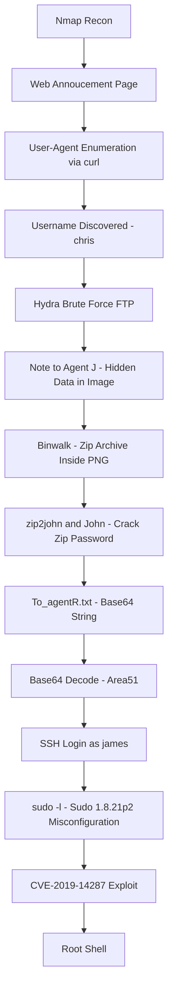

# Agent Sudo — Offensive Security Lab Notes

A structured cybersecurity knowledge base documenting the methodology, commands, and observations from a hands-on penetration testing lab covering web enumeration, FTP brute-forcing, steganography, credential recovery, and Linux privilege escalation via a sudo security bypass (CVE-2019-14287).


---

## About This Repository

This repository is **not a walkthrough or a solution guide**. It is a personal knowledge base built from lab notes, terminal history, and screenshots captured while working through a self-hosted penetration testing exercise.

Each document in this repository records:

- The **methodology** used to move from initial reconnaissance to root access
- The **exact commands executed**, with no fabricated syntax or output
- **Observations and reasoning** behind each decision point
- Reusable **cheat sheets** for the tools involved

All content is derived from real terminal output and screenshots. Where supplementary explanation is added for learning purposes, it is clearly separated under an **Additional Context** section in each document.

> [!IMPORTANT]
> This repository documents activity performed against a private, authorized lab environment. No production systems, third-party services, or unauthorized targets were involved. All IP addresses shown belong to private (RFC 1918-style) lab address ranges and are not reachable externally.

## Table of Contents

- [About This Repository](#about-this-repository)
- [Repository Structure](#repository-structure)
- [Learning Objectives](#learning-objectives)
- [Topics Covered](#topics-covered)
- [Attack Chain Overview](#attack-chain-overview)
- [Tools Used](#tools-used)
- [Cheat Sheets](#cheat-sheets)
- [Repository Statistics](#repository-statistics)
- [Future Improvements](#future-improvements)
- [Acknowledgements](#acknowledgements)
- [License](#license)

## Repository Structure

```text
.
├── README.md                          Landing page
├── LICENSE
├── .gitignore
│
├── docs/
│   ├── 01-Recon/                      Nmap scanning and service discovery
│   ├── 02-Enumeration/                Web enumeration methodology
│   ├── 03-Web/                        HTTP header based access control
│   ├── 04-FTP/                        FTP credential brute-forcing
│   ├── 05-Credentials/                Steganography, archive cracking, encoding
│   ├── 06-Initial-Access/             SSH foothold
│   └── 07-Privilege-Escalation/       sudo CVE-2019-14287 root escalation
│
├── cheatsheets/                       Standalone tool reference sheets
│   ├── Nmap.md
│   ├── FFUF.md
│   ├── FTP.md
│   ├── Hashcat.md
│   ├── Netcat.md
│   ├── Linux-Enumeration.md
│   ├── Privilege-Escalation.md
│   └── Reverse-Shells.md
│
├── images/                            Screenshots referenced throughout docs/
└── resources/                         Supplementary reference material
```

## Learning Objectives

- Practice a structured penetration testing methodology: recon, enumeration, exploitation, privilege escalation
- Understand how custom HTTP header logic (`User-Agent`) can be misused as a weak access-control mechanism
- Perform credential brute-forcing against a network service (FTP)
- Extract hidden data from image files using file-carving and steganography techniques
- Crack a password-protected ZIP archive with John the Ripper
- Recognize and exploit a real-world CVE (CVE-2019-14287 — sudo security bypass)
- Produce clear, professional security documentation

## Topics Covered

| Domain | Description |
|---|---|
| Network reconnaissance | Full TCP port scanning and service/version detection with Nmap |
| Web enumeration | Inspecting HTTP responses and sending requests with custom headers via `curl` |
| Access control bypass | Exploiting `User-Agent`-based logic on a web server |
| Brute-force attacks | Cracking FTP credentials with Hydra and `rockyou.txt` |
| Steganography | Extracting an embedded archive from a PNG file with `binwalk` |
| Password cracking | Using `zip2john` and `john` to crack a protected ZIP archive |
| Encoding | Identifying and decoding a Base64-encoded string |
| Initial access | Gaining a foothold via SSH with recovered credentials |
| Privilege escalation | Abusing a sudo misconfiguration (CVE-2019-14287) to obtain root |

## Attack Chain Overview



> [!NOTE]
> Each stage of this chain is documented in detail in its corresponding folder under [`docs/`](./docs/).

## Tools Used

| Tool | Purpose |
|---|---|
| [Nmap](https://nmap.org/) | Port scanning and service/version detection |
| [curl](https://curl.se/) | Manual HTTP requests with custom headers |
| [Hydra](https://github.com/vanhauser-thc/thc-hydra) | Network login brute-forcing |
| [binwalk](https://github.com/ReFirmLabs/binwalk) | File carving and embedded-file detection |
| [John the Ripper](https://www.openwall.com/john/) | Hash extraction (`zip2john`) and password cracking |
| [7-Zip](https://www.7-zip.org/) | Archive extraction |
| Base64 decoder | Decoding Base64-encoded strings |
| [OpenSSH](https://www.openssh.com/) | Remote shell access |
| [Exploit-DB](https://www.exploit-db.com/exploits/47502) | Public exploit reference for CVE-2019-14287 |

## Cheat Sheets

Quick-reference sheets for the tools used throughout this lab live in [`cheatsheets/`](./cheatsheets/):

- [Nmap](./cheatsheets/Nmap.md)
- [FFUF](./cheatsheets/FFUF.md)
- [FTP](./cheatsheets/FTP.md)
- [Hashcat](./cheatsheets/Hashcat.md)
- [Netcat](./cheatsheets/Netcat.md)
- [Linux Enumeration](./cheatsheets/Linux-Enumeration.md)
- [Privilege Escalation](./cheatsheets/Privilege-Escalation.md)
- [Reverse Shells](./cheatsheets/Reverse-Shells.md)

## Repository Statistics

| Metric | Count |
|---|---|
| Documentation sections | 7 |
| Cheat sheets | 8 |
| Screenshots archived | 13 |
| CVEs documented | 1 (CVE-2019-14287) |

## Future Improvements

- [ ] Add a dedicated FFUF/directory brute-forcing walkthrough once corresponding fuzzing output is captured
- [ ] Add password/hash-cracking timing benchmarks
- [ ] Add a network diagram of the lab topology
- [ ] Expand the Linux Enumeration cheat sheet with sample LinEnum/linpeas output
- [ ] Add a short retrospective to each section summarizing lessons learned

## Acknowledgements

- Public exploit research referenced from [Exploit-DB](https://www.exploit-db.com/exploits/47502)
- Structure and formatting inspired by community security documentation projects, including HackTricks, PayloadsAllTheThings, and OWASP

## License

This repository is licensed under the [MIT License](./LICENSE). All content is provided for educational purposes only.
