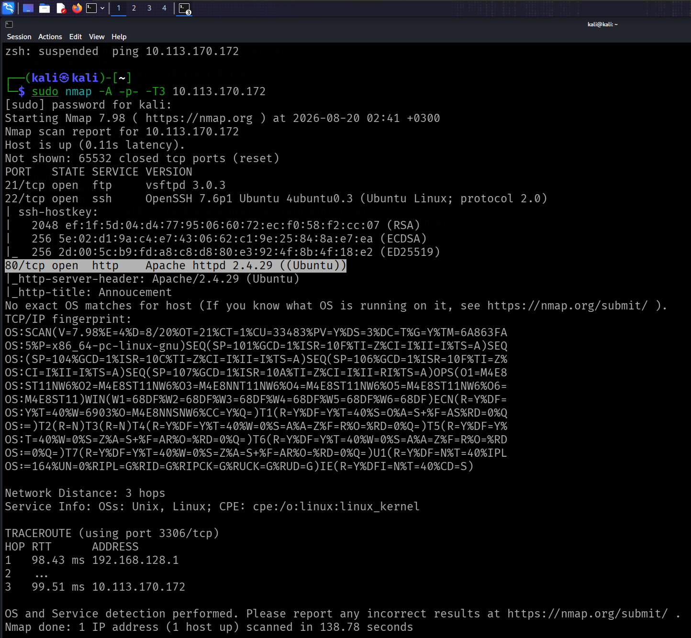

# 01 — Reconnaissance

## Overview

The first phase of the engagement focused on identifying live services on the target host `10.113.170.172` using a full-port Nmap scan with service/version detection and default script scanning.

## Objectives

- Identify all open TCP ports on the target
- Fingerprint running services and their versions
- Fingerprint the underlying operating system
- Identify any immediately interesting attack surface (web, FTP, SSH)

## Important Terminology

| Term | Definition |
|---|---|
| **Port Scanning** | Probing a host for open network ports to determine which services are reachable |
| **Service/Version Detection** | Identifying the exact software and version listening on an open port |
| **OS Fingerprinting** | Inferring the target's operating system from TCP/IP stack behavior |
| **TTL / Network Distance** | Number of network hops between scanner and target, useful for identifying routing/NAT |

## Concepts Explained

A full-port scan (`-p-`) ensures no service is missed by only checking the default top 1000 ports. Combining this with `-A` enables OS detection, version detection, script scanning, and traceroute in a single pass — at the cost of scan speed.

## Commands and Syntax

```bash
sudo nmap -A -p- -T3 10.113.170.172
```

### Command Breakdown

| Component | Purpose |
|---|---|
| `sudo` | Required for raw socket operations used by OS fingerprinting |
| `nmap` | The scanning tool |
| `-A` | Enables OS detection, version detection, script scanning, and traceroute |
| `-p-` | Scans all 65535 TCP ports (not just the default top 1000) |
| `-T3` | Timing template — "Normal" speed, balances speed and reliability |
| `10.113.170.172` | Target IP address |

**Why it was used:** A full-range aggressive scan was chosen to guarantee complete port coverage on an unknown target and to gather as much service/version/OS data as possible in a single command.

## Examples

Full command exactly as executed:

```bash
sudo nmap -A -p- -T3 10.113.170.172
```

### Observed Result

```text
Starting Nmap 7.98 ( https://nmap.org ) at 2026-08-20 02:41 +0300
Nmap scan report for 10.113.170.172
Host is up (0.11s latency).
Not shown: 65532 closed tcp ports (reset)
PORT   STATE SERVICE VERSION
21/tcp open  ftp     vsftpd 3.0.3
22/tcp open  ssh     OpenSSH 7.6p1 Ubuntu 4ubuntu0.3 (Ubuntu Linux; protocol 2.0)
| ssh-hostkey:
|   2048 ef:1f:5d:04:d4:77:95:06:60:72:ec:f0:58:f2:cc:07 (RSA)
|   256 5e:02:d1:9a:c4:e7:43:06:62:c1:9e:25:84:8a:e7:ea (ECDSA)
|_  256 2d:00:5c:b9:fd:a8:c8:d8:80:e3:92:4f:8b:4f:18:e2 (ED25519)
80/tcp open  http    Apache httpd 2.4.29 ((Ubuntu))
|_http-server-header: Apache/2.4.29 (Ubuntu)
|_http-title: Annoucement
No exact OS matches for host
Network Distance: 3 hops
Service Info: OSs: Unix, Linux; CPE: cpe:/o:linux:linux_kernel

TRACEROUTE (using port 3306/tcp)
HOP RTT      ADDRESS
1   98.43 ms 192.168.128.1
2   ...
3   99.51 ms 10.113.170.172

Nmap done: 1 IP address (1 host up) scanned in 138.78 seconds
```



## Observations

| Port | Service | Version | Notes |
|---|---|---|---|
| 21/tcp | FTP | vsftpd 3.0.3 | Potential brute-force / anonymous login target |
| 22/tcp | SSH | OpenSSH 7.6p1 (Ubuntu) | Foothold service, requires valid credentials |
| 80/tcp | HTTP | Apache httpd 2.4.29 (Ubuntu) | Page title `Annoucement` — worth manual review |

- The scan reported **3 network hops**, and traceroute used **port 3306/tcp** (MySQL) as the probe port even though MySQL was not found open — this is simply Nmap's default traceroute probe behavior when no better port is available.
- No exact OS match was returned, but service banners strongly indicate **Ubuntu Linux**.
- The HTTP page title "Annoucement" (note the typo) stood out as a manual next step.

## Common Mistakes

- Forgetting `-p-` and only scanning the default 1000 ports, which can miss non-standard services.
- Skipping `sudo`, which silently disables SYN scan and OS fingerprinting, falling back to a less accurate connect scan.
- Treating a "No exact OS matches" result as inconclusive — service banners (`OpenSSH ... Ubuntu`, `Apache ... (Ubuntu)`) are often more reliable than the raw TCP/IP fingerprint.

## Notes

- The full 65535-port scan took **138.78 seconds**, illustrating the trade-off of using `-p-` with `-T3` versus a faster top-ports-only scan.
- The three open ports (FTP, SSH, HTTP) form the entire external attack surface for this host.

## Additional Context

> [!NOTE]
> The following is supplementary background, not derived from the lab notes.

Nmap's `-A` flag is a convenience aggregate flag. In real engagements it is common to instead run individual scans (`-sV`, `-O`, `-sC`, `--traceroute`) separately so that OS detection or script scanning can be tuned or skipped when not needed, since `-A` scans are noisier and slower.

## References

- [Nmap Official Documentation](https://nmap.org/book/man.html)
- [Nmap Timing Templates](https://nmap.org/book/performance-timing-templates.html)

## Key Takeaways

- A full TCP port sweep combined with version detection is the fastest way to build an accurate picture of a target's attack surface.
- Unusual details in banners (like a page titled "Annoucement") are strong signals to investigate manually rather than relying solely on automated tooling.
- FTP, SSH, and HTTP being open together is a common combination that suggests a layered attack path: web recon → credential discovery → remote login.

---

**Next:** [02 — Enumeration](../02-Enumeration/README.md)
