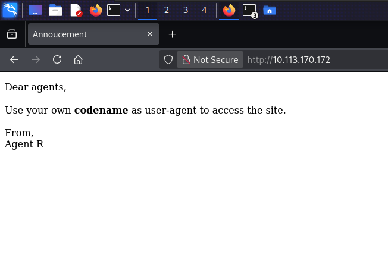

# 02 — Enumeration

## Overview

With three services identified during recon (FTP, SSH, HTTP), enumeration focused on manually reviewing the web service on port 80, since it had a distinctive page title (`Annoucement`) flagged by Nmap's `http-title` script.

## Objectives

- Manually browse and inspect the web application on port 80
- Identify any access-control logic, hidden instructions, or clues left on the page
- Determine the next attack vector based on page content

## Important Terminology

| Term | Definition |
|---|---|
| **`http-title`** | An Nmap NSE script that extracts the `<title>` tag of a web page during scanning |
| **Enumeration** | The process of actively gathering detailed information about identified services |
| **Codename / User-Agent gate** | A custom, non-standard access control scheme implemented by the target application, keyed off the HTTP `User-Agent` header |

## Concepts Explained

Standard web enumeration begins with simply visiting the site in a browser to read any visible content before running automated scanners (directory brute-forcing, vulnerability scanners, etc.). In this case, the landing page itself contained an explicit instruction rather than a typical login form, changing the enumeration approach from "find hidden paths" to "interact with the HTTP header logic described on the page."

## Commands and Syntax

No terminal commands were required for this step — enumeration was performed by navigating to the target URL in a browser.

```text
http://10.113.170.172
```

## Examples

Navigating to the target root URL in Firefox returned the following page:

```text
Dear agents,

Use your own codename as user-agent to access the site.

From,
Agent R
```



## Observations

- The page directly instructs the visitor to supply a personal **"codename"** as the `User-Agent` HTTP header value to gain further access.
- This implies the application performs **server-side logic based on the `User-Agent` string**, rather than a conventional authentication form.
- The word "agents" and "codename" suggest a themed CTF-style narrative involving multiple fictional personas (later confirmed to include "Agent R", "Agent C", and others).
- This finding directly informs the next phase — see [`03-Web`](../03-Web/README.md) — where the `User-Agent` header is manipulated with `curl`.

## Common Mistakes

- Relying only on automated scanners and never manually reading the page content — this specific clue would have been missed by a directory brute-forcer alone.
- Assuming a "codename" must be a random guess; in practice, values were tested logically based on later-discovered context (e.g. single-letter codenames matching character names encountered further into the lab).

## Notes

- No forms, cookies, or client-side JavaScript were involved — the entire access-control mechanism is server-side and header-based.
- This is a good reminder that **enumeration is not limited to tools** — reading page text carefully is itself a valid and necessary enumeration step.

## Additional Context

> [!NOTE]
> The following is supplementary background, not derived from the lab notes.

Relying on the `User-Agent` header for access control is a well-known **anti-pattern** in real-world web security. The header is fully client-controlled and trivially spoofed with tools like `curl -A`, browser extensions, or proxy tools such as Burp Suite. It provides no real authentication or authorization guarantee and should never be used as a security boundary in production systems.

## References

- [OWASP: Testing for Weak Access Control](https://owasp.org/www-project-web-security-testing-guide/)
- [MDN: User-Agent header](https://developer.mozilla.org/en-US/docs/Web/HTTP/Headers/User-Agent)

## Key Takeaways

- Always manually browse a discovered web service before jumping to automated tools — page content can directly reveal the intended attack path.
- A page instructing the visitor to change a specific HTTP header is a strong signal that the target implements custom, and likely insecure, header-based logic.

---

**Previous:** [01 — Recon](../01-Recon/README.md) · **Next:** [03 — Web](../03-Web/README.md)
