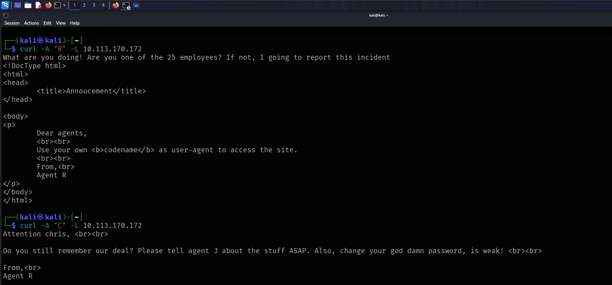

# 03 — Web (User-Agent Based Access Control)

## Overview

The web application on port 80 keys its response content off the HTTP `User-Agent` header. This section documents using `curl` to manually spoof the `User-Agent` header with different "codenames" to reveal hidden, agent-specific messages.

## Objectives

- Send HTTP requests with a custom `User-Agent` header using `curl`
- Iterate through plausible codenames to discover hidden content
- Extract any usernames, credentials, or leads from returned messages

## Important Terminology

| Term | Definition |
|---|---|
| `-A` / `--user-agent` | curl flag used to set a custom `User-Agent` request header |
| `-L` / `--location` | curl flag that follows HTTP redirects |
| **IDOR-like header logic** | Server-side logic that returns different content based on an easily-guessable, user-controlled value (here, the `User-Agent` string) |

## Concepts Explained

Because the site explicitly asked visitors to "use your own codename as user-agent," the logical attack was to brute-force / manually test single-letter or short codenames as the `User-Agent` value using `curl -A`. This is a direct, low-effort way to interact with server logic that a normal browser session would not expose without manually editing headers.

## Commands and Syntax

```bash
curl -A "<codename>" -L <target-ip>
```

### Command Breakdown

| Argument | Description |
|---|---|
| `curl` | Command-line HTTP client |
| `-A "<codename>"` | Sets the `User-Agent` header to the given string |
| `-L` | Follows any HTTP redirects returned by the server |
| `<target-ip>` | The target host (`10.113.170.172`) |

**Why it was used:** `curl` allows precise, scriptable control over HTTP headers, making it the fastest way to test different `User-Agent` values without needing a browser extension.

## Examples

### Attempt 1 — User-Agent: `R`

```bash
curl -A "R" -L 10.113.170.172
```

**Observed result:**

```text
What are you doing! Are you one of the 25 employees? If not, I going to report this incident
<!DocType html>
<html>
<head>
        <title>Annoucement</title>
</head>

<body>
<p>
        Dear agents,
        <br><br>
        Use your own <b>codename</b> as user-agent to access the site.
        <br><br>
        From,<br>
        Agent R
</p>
</body>
</html>
```

### Attempt 2 — User-Agent: `C`

```bash
curl -A "C" -L 10.113.170.172
```

**Observed result:**

```text
Attention chris, <br><br>

Do you still remember our deal? Please tell agent J about the stuff ASAP. Also, change your god damn password, is weak! <br><br>

From,<br>
Agent R
```



## Observations

- The codename `R` returned the **default/warning page**, indicating `R` is not treated as a valid "agent" codename by the server logic (or is the admin/default fallback).
- The codename `C` returned a **personalized message addressed to "chris"**, revealing:
  - A username: **`chris`**
  - A hint that `chris`'s password is **weak** — directly suggesting a dictionary/brute-force attack (see [`04-FTP`](../04-FTP/README.md))
  - A reference to **"Agent J"**, indicating additional personas/users exist (later relevant in [`05-Credentials`](../05-Credentials/README.md))

## Common Mistakes

- Testing only obvious codenames like `admin` or `agent` instead of the actual single-letter naming convention implied by the page ("Agent R", "Agent C").
- Not using `-L` and missing content served behind a redirect.
- Overlooking that the *response itself* contains a plaintext username (`chris`) and an explicit weak-password hint — easy to skim past in a wall of HTML.

## Notes

- No authentication token, cookie, or session was required — headers alone determined the response content, confirming this is purely `User-Agent` string matching on the server side.
- The username `chris` and the "weak password" hint directly justify the brute-force approach taken in the next phase.

## Additional Context

> [!NOTE]
> The following is supplementary background, not derived from the lab notes.

This pattern — content or access gated behind a client-supplied header — is sometimes seen in real-world scenarios as a (weak) bot-blocking mechanism or an intentionally obscure "security through obscurity" control. It should never be relied upon as an actual authentication mechanism, since headers can be freely scripted and enumerated exactly as demonstrated here.

## References

- [curl Manual — `-A, --user-agent`](https://curl.se/docs/manpage.html)
- [OWASP Top 10 — A01:2021 Broken Access Control](https://owasp.org/Top10/A01_2021-Broken_Access_Control/)

## Key Takeaways

- User-controlled headers should never be trusted as an authentication boundary — this exercise demonstrates exactly why.
- Manually iterating short/likely values in a custom header can reveal hidden server-side logic that automated scanners would miss.
- The leaked username `chris` and the accompanying "weak password" hint directly justify the FTP brute-force attack performed next.

---

**Previous:** [02 — Enumeration](../02-Enumeration/README.md) · **Next:** [04 — FTP](../04-FTP/README.md)
