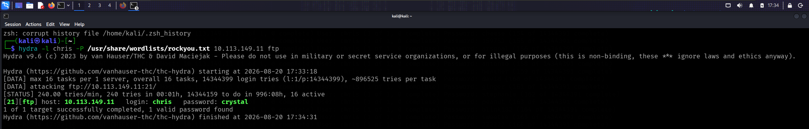

# 04 — FTP Credential Brute-Forcing

## Overview

Using the username `chris` (discovered in [03-Web](../03-Web/README.md)) and the explicit hint that the password was "weak," a dictionary attack was performed against the FTP service identified during recon using **Hydra** and the `rockyou.txt` wordlist.

## Objectives

- Confirm the FTP service accepts password authentication for the user `chris`
- Recover the password using a dictionary/brute-force attack
- Establish valid FTP credentials for further access

## Important Terminology

| Term | Definition |
|---|---|
| **Hydra** | A fast network login cracker supporting many protocols (FTP, SSH, HTTP, etc.) |
| **Dictionary attack** | An attack that tries every entry in a wordlist as a candidate password |
| **rockyou.txt** | A widely used leaked password wordlist commonly bundled with Kali Linux |

## Concepts Explained

Since the web page explicitly hinted that `chris`'s password was weak, a targeted dictionary attack against a single known username is far more efficient than a full username+password combination attack. `rockyou.txt` is the standard first choice for this kind of attack due to its size and real-world password coverage.

## Commands and Syntax

```bash
hydra -l <username> -P <wordlist> <target> <service>
```

### Command Breakdown

| Argument | Description |
|---|---|
| `-l chris` | Specifies a single, known username to test |
| `-P /usr/share/wordlists/rockyou.txt` | Path to the password wordlist to iterate through |
| `10.113.149.11` | Target IP address running the FTP service |
| `ftp` | Target protocol/service module for Hydra |

**Why it was used:** The username was already known and confirmed weak, making a single-user password spray with Hydra the most direct route to valid credentials.

## Examples

```bash
hydra -l chris -P /usr/share/wordlists/rockyou.txt 10.113.149.11 ftp
```

### Observed Result

```text
Hydra v9.6 (c) 2023 by van Hauser/THC & David Maciejak - Please do not use in military or secret service organizations, or for illegal purposes (this is non-binding, these ** ignore laws and ethics anyway).

Hydra (https://github.com/vanhauser-thc/thc-hydra) starting at 2026-08-20 17:33:18
[DATA] max 16 tasks per 1 server, overall 16 tasks, 14344399 login tries (l:1/p:14344399), ~896525 tries per task
[DATA] attacking ftp://10.113.149.11:21/
[STATUS] 240.00 tries/min, 240 tries in 00:01h, 14344159 to do in 996:08h, 16 active
[21][ftp] host: 10.113.149.11   login: chris   password: crystal
1 of 1 target successfully completed, 1 valid password found
Hydra (https://github.com/vanhauser-thc/thc-hydra) finished at 2026-08-20 17:34:31
```



## Observations

- Valid FTP credentials recovered:

  | Username | Password | Service |
  |---|---|---|
  | `chris` | `crystal` | FTP (port 21) |

- Hydra found the correct password in **73 seconds**, confirming the password was indeed weak/dictionary-crackable as hinted.
- Note the target IP changed from `10.113.170.172` (used during recon/web enumeration) to `10.113.149.11` for this and subsequent steps — consistent with a multi-stage or re-deployed lab environment.

## Common Mistakes

- Running Hydra against multiple usernames simultaneously when only one is known — this wastes significant time (note the estimated "996:08h" to complete against the *entire* wordlist if the password had not been found quickly).
- Not limiting tasks (`-t`) on a lab environment that may rate-limit or lock accounts after repeated failed logins.
- Forgetting that FTP credentials often double as SSH or other service credentials in these types of environments — worth testing broadly once recovered.

## Notes

- The recovered FTP password (`crystal`) was tested but **is distinct from** the SSH password used later in [`06-Initial-Access`](../06-Initial-Access/README.md) — credential reuse should always be tested, but was not assumed blindly here.
- This stage produced the first fully working credential pair of the engagement.

## Additional Context

> [!NOTE]
> The following is supplementary background, not derived from the lab notes.

`rockyou.txt` originates from a 2009 real-world data breach of the RockYou company and remains one of the most effective wordlists for weak, human-chosen passwords because it reflects actual password reuse patterns. In real engagements, always confirm the target's account lockout policy before running high-volume brute-force attacks, since Hydra-style attacks can trigger denial-of-service conditions or account lockouts on production systems.

## References

- [THC-Hydra GitHub Repository](https://github.com/vanhauser-thc/thc-hydra)
- [SecLists Wordlists Collection](https://github.com/danielmiessler/SecLists)

## Key Takeaways

- A hint about password strength ("weak password") is a strong justification to move directly to a targeted dictionary attack instead of broader enumeration.
- `hydra -l <user> -P <wordlist> <target> <service>` is the standard syntax for a single-user password spray.
- Recovering FTP access (`chris:crystal`) provided the credentials used to explore the filesystem in the next phase.

---

**Previous:** [03 — Web](../03-Web/README.md) · **Next:** [05 — Credentials](../05-Credentials/README.md)
