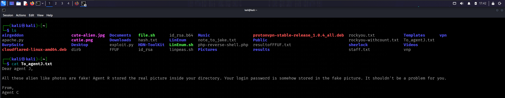
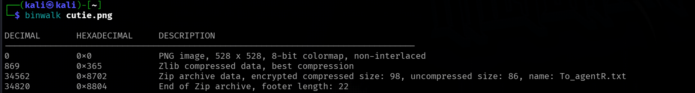
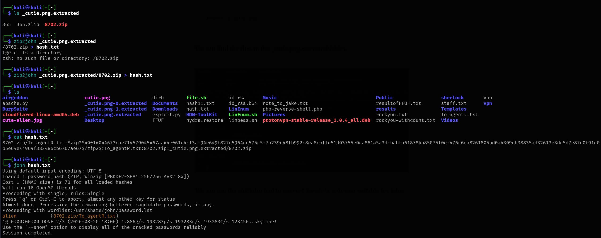
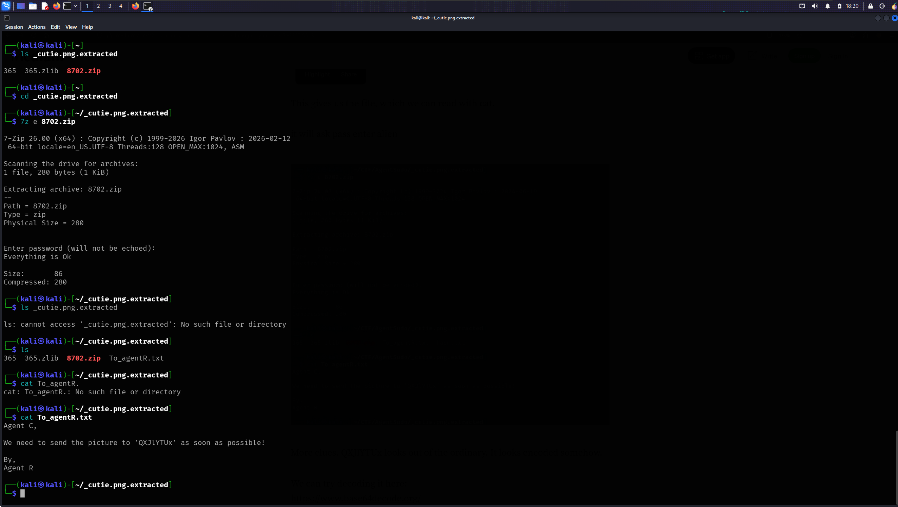
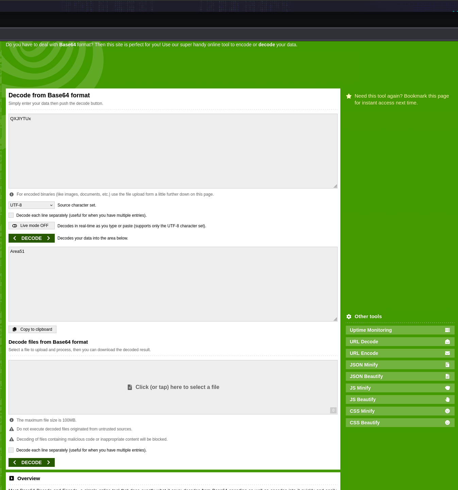

# 05 — Credential Recovery (Steganography, Archive Cracking, Encoding)

## Overview

After gaining FTP access as `chris`, the home/FTP directory contained a note addressed to "Agent J" claiming that a real password was hidden inside an image file disguised among fake "alien" photos. This section documents extracting a hidden ZIP archive from a PNG using `binwalk`, cracking the ZIP's password with `zip2john`/`john`, extracting the archive with `7z`, and decoding a Base64 string found inside — the longest and most technical chain in the engagement.

## Objectives

- Enumerate files transferred/available via FTP access
- Identify hidden data embedded inside an image file
- Extract an embedded, password-protected ZIP archive from the image
- Crack the ZIP password using `zip2john` and `john`
- Extract the archive contents and decode a Base64-encoded string found inside

## Important Terminology

| Term | Definition |
|---|---|
| **Steganography** | The practice of concealing data (e.g. files, text) inside another file, such as an image |
| **binwalk** | A tool for analyzing and extracting embedded files/data from binary blobs (firmware, images, etc.) |
| **zip2john** | A John the Ripper utility that converts a password-protected ZIP file into a crackable hash format |
| **John the Ripper (`john`)** | A password/hash cracking tool supporting many hash formats and cracking modes |
| **Base64** | A binary-to-text encoding scheme commonly used to represent short strings or binary data as ASCII text |

## Concepts Explained

PNG (and many other) file formats only require a valid header and defined structure to be recognized as displayable images — trailing data appended after the image's own end-of-file marker is ignored by image viewers but can still be extracted with a carving tool like `binwalk`. This is a classic technique for hiding a secondary file (in this case, a ZIP archive) inside an otherwise normal-looking image.

## Commands and Syntax

### Step 1 — List files and read the note

```bash
ls
cat To_agentJ.txt
```

### Step 2 — Carve embedded data from the image

```bash
binwalk cutie.png
```

| Argument | Description |
|---|---|
| `binwalk` | Signature-based binary analysis and extraction tool |
| `cutie.png` | Target image file suspected of containing hidden data |

### Step 3 — Extract identified embedded ZIP

```bash
binwalk -e cutie.png
```

*(Extraction directory `_cutie.png.extracted/` was produced containing the carved ZIP.)*

### Step 4 — Convert the ZIP into a crackable hash

```bash
zip2john _cutie.png.extracted/8702.zip > hash.txt
```

### Step 5 — Crack the hash with John the Ripper

```bash
john hash.txt
```

### Step 6 — Extract the ZIP using the recovered password

```bash
cd _cutie.png.extracted
7z e 8702.zip
```

### Step 7 — Read the extracted note and decode Base64

```bash
cat To_agentR.txt
```

Followed by decoding the Base64 string found inside using a Base64 decode tool.

### Command Breakdown

| Command | Purpose | Key Flags |
|---|---|---|
| `binwalk cutie.png` | Scans the file for embedded file signatures | none |
| `zip2john <file.zip> > hash.txt` | Extracts a crackable hash representation of the ZIP's password | output redirected to `hash.txt` |
| `john hash.txt` | Attempts to crack the extracted hash | uses John's default wordlist (`/usr/share/john/password.lst`) |
| `7z e 8702.zip` | Extracts files from the ZIP archive, prompting for the password | `e` = extract without preserving folder structure |

**Why each was used:** `binwalk` was used because the note explicitly stated the real data was "stored inside the fake picture." `zip2john`/`john` were used because the extracted ZIP was password-protected. `7z` was used to perform the actual extraction once the password was known.

## Examples

### Directory Listing and Note to Agent J

```bash
ls
```

```text
airgeddon    cute-alien.jpg  Documents  file.sh      id_rsa.b64  Music   protonvpn-stable-release_1.0.4_all.deb  rockyou.txt              Templates    vpn
apache.py    cutie.png       Downloads  hash.txt     id_rsa      note_to_jake.txt  php-reverse-shell.php  rockyou-withcount.txt   To_agentJ.txt
BurpSuite    Desktop         dirb       HDN-ToolKit  LinEnum     Pictures      resultofFFUF.txt        sherlock                Videos
cloudflared-linux-amd64.deb  exploit.py  FFUF       LinEnum.sh   linpeas.sh    Public        results                 staff.txt               vnp
```

```bash
cat To_agentJ.txt
```

```text
Dear agent J,

All these alien like photos are fake! Agent R stored the real picture inside your directory. Your login password is somehow stored in the fake picture. It shouldn't be a problem for you.

From,
Agent C
```



### binwalk Analysis of `cutie.png`

```bash
binwalk cutie.png
```

```text
DECIMAL       HEXADECIMAL     DESCRIPTION
--------------------------------------------------------------------------------
0             0x0             PNG image, 528 x 528, 8-bit colormap, non-interlaced
869           0x365           Zlib compressed data, best compression
34562         0x8702          Zip archive data, encrypted compressed size: 98, uncompressed size: 86, name: To_agentR.txt
34820         0x8804          End of Zip archive, footer length: 22
```



> [!TIP]
> The offset `0x8702` in the binwalk output directly corresponds to the extracted filename `8702.zip` seen in the following steps — `binwalk -e` names extracted carved files after their hex offset.

### Extraction, Hash Cracking

```bash
ls _cutie.png.extracted
```

```text
365  365.zlib  8702.zip
```

```bash
zip2john _cutie.png.extracted/8702.zip > hash.txt
cat hash.txt
```

```text
8702.zip/To_agentR.txt:$zip2$*0*1*0*4673cae71457045*67aa*4e*61c4cf3af94e649f827e5964ce575c5f7a239c48fb992c8ea8cbffe51d03755e0ca861a5a3dcbabfa618784b85075f0ef476c6da8261805bd0a4309db38835ad32613e3dc5d7e87c0f91c0b5e64e*4969f382486cb6767ae6*$/zip2$:To_agentR.txt:8702.zip:_cutie.png.extracted/8702.zip
```

```bash
john hash.txt
```

```text
Using default input encoding: UTF-8
Loaded 1 password hash (ZIP, WinZip [PBKDF2-SHA1 256/256 AVX2 8x])
Cost 1 (HMAC size) is 78 for all loaded hashes
Will run 16 OpenMP threads
Proceeding with single, rules:Single
Press 'q' or Ctrl-C to abort, almost any other key for status
Almost done: Processing the remaining buffered candidate passwords, if any.
Proceeding with wordlist:/usr/share/john/password.lst
alien            (8702.zip/To_agentR.txt)
1g 0:00:00:00 DONE 2/3 (2026-08-20 18:06) 1.886g/s 193283p/s 193283c/s 193283C/s 123456..skyline!
Use the "--show" option to display all of the cracked passwords reliably
Session completed.
```



> [!IMPORTANT]
> The cracked ZIP password is **`alien`** — a fitting theme given the "alien like photos" mentioned in the note to Agent J.

### Extraction with 7-Zip and the Note to Agent R

```bash
cd _cutie.png.extracted
7z e 8702.zip
```

```text
7-Zip 26.00 (x64) : Copyright (c) 1999-2026 Igor Pavlov : 2026-02-12
 64-bit locale=en_US.UTF-8 Threads:128 OPEN_MAX:1024, ASM

Scanning the drive for archives:
1 file, 280 bytes (1 KiB)

Extracting archive: 8702.zip
--
Path = 8702.zip
Type = zip
Physical Size = 280

Enter password (will not be echoed):
Everything is Ok

Size:       86
Compressed: 280
```

```bash
cat To_agentR.txt
```

```text
Agent C,

We need to send the picture to 'QXJlYTUx' as soon as possible!

By,
Agent R
```



### Base64 Decoding

The string `QXJlYTUx` found in the note to Agent R was identified as Base64-encoded text and decoded using an online Base64 decode tool.

```text
Input:  QXJlYTUx
Output: Area51
```



## Observations

- `binwalk` confirmed `cutie.png` contained a legitimate PNG image **plus** a hidden Zlib-compressed blob and an encrypted ZIP archive appended after the image data.
- The embedded ZIP contained a single file: `To_agentR.txt`.
- The ZIP's password hash was crackable using John's built-in wordlist (`password.lst`) in under a second — the password (`alien`) was thematically related to the "fake alien photos" mentioned in the earlier note.
- The extracted note revealed a Base64 string (`QXJlYTUx`), which decoded to the plaintext value **`Area51`**.
- Given the earlier notes referencing "login password ... stored in the fake picture," `Area51` is very likely a **password or passphrase** for a subsequent login (used next in [06-Initial-Access](../06-Initial-Access/README.md)).

## Common Mistakes

- Running `zip2john` directly on the extraction folder instead of the actual `.zip` file path (`fgetc: Is a directory` error) — the correct target must be the specific `8702.zip` file.
- Assuming `binwalk`'s default (non-extraction) run automatically extracts embedded files — the `-e` flag (or an equivalent extraction step) is required to actually carve out the identified archive.
- Forgetting that John the Ripper's cracked passwords must be viewed again later with `john --show hash.txt` if the original cracking output scrolls out of view.
- Treating the decoded Base64 string (`Area51`) as final plaintext without testing where it might be used (e.g., as a login password).

## Notes

- This chain represents a **layered obfuscation puzzle**: image → embedded ZIP → password-protected archive → text note → Base64-encoded string → final plaintext value.
- Each "Agent" note in the story (Agent R, Agent C, Agent J) functioned as an in-narrative breadcrumb pointing to the next required technique.

## Additional Context

> [!NOTE]
> The following is supplementary background, not derived from the lab notes.

Appending extra data after a PNG's IEND chunk is one of the simplest steganography techniques because most image viewers and libraries stop reading at the expected end-of-image marker, silently ignoring anything appended afterward. Tools like `binwalk`, `foremost`, or manual `dd`/`xxd` offset extraction are the standard way to recover such appended data. Similarly, ZIP password cracking via `zip2john`/`john` works because ZipCrypto and even AES-based ZIP encryption schemes are only as strong as the chosen password — weak, dictionary-based passwords (like `alien`) are trivially recovered.

## References

- [binwalk GitHub Repository](https://github.com/ReFirmLabs/binwalk)
- [John the Ripper — Zip Cracking](https://www.openwall.com/john/)
- [PNG File Format Specification](https://www.w3.org/TR/png/)

## Key Takeaways

- Always inspect "innocent" files like images for embedded/appended data when a narrative or note explicitly hints at hidden content.
- `binwalk` → `zip2john` → `john` → `7z e` is a reliable, repeatable pipeline for recovering data hidden inside an image via an embedded encrypted archive.
- Always decode encountered Base64 strings — they frequently contain credentials, hostnames, or other pivotal values (`QXJlYTUx` → `Area51` in this case).

---

**Previous:** [04 — FTP](../04-FTP/README.md) · **Next:** [06 — Initial Access](../06-Initial-Access/README.md)
