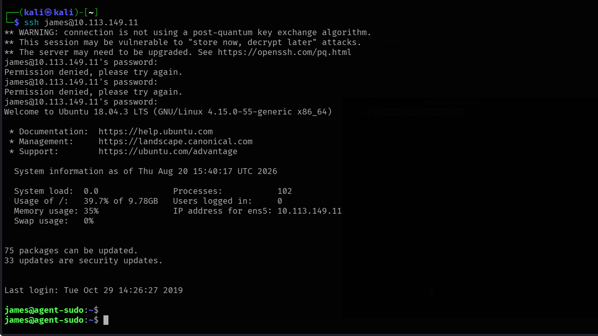

# 06 — Initial Access (SSH)

## Overview

Using the recovered value `Area51` from [05-Credentials](../05-Credentials/README.md), an SSH login attempt was made against the target as user `james`, resulting in a successful authenticated shell.

## Objectives

- Attempt SSH authentication using the recovered credential
- Confirm a valid shell foothold on the target system
- Begin post-authentication enumeration of the local environment

## Important Terminology

| Term | Definition |
|---|---|
| **SSH (Secure Shell)** | An encrypted remote administration protocol used to obtain a shell on a remote host |
| **Foothold** | The first successful authenticated access point into a target system |
| **Post-quantum key exchange** | A newer class of key exchange algorithms resistant to future quantum-computing based attacks; OpenSSH warns when a connection does not use one |

## Concepts Explained

Once a plausible credential (username + password) is recovered during an engagement, testing it directly against any available authentication service (SSH, in this case) is the natural next step to establish a persistent, interactive foothold rather than continuing to operate purely through FTP or HTTP.

## Commands and Syntax

```bash
ssh <username>@<target-ip>
```

### Command Breakdown

| Argument | Description |
|---|---|
| `ssh` | OpenSSH client used to establish a remote shell session |
| `james` | Username tested for authentication |
| `10.113.149.11` | Target IP address |

**Why it was used:** `james` was inferred as a valid system username from the earlier narrative notes (Agent J / "agent J"), and `Area51` was the plaintext value recovered from the Base64-encoded note.

## Examples

```bash
ssh james@10.113.149.11
```

### Observed Result

```text
** WARNING: connection is not using a post-quantum key exchange algorithm.
** This session may be vulnerable to "store now, decrypt later" attacks.
** The server may need to be upgraded. See https://openssh.com/pq.html
james@10.113.149.11's password:
Permission denied, please try again.
james@10.113.149.11's password:
Permission denied, please try again.
james@10.113.149.11's password:
Welcome to Ubuntu 18.04.3 LTS (GNU/Linux 4.15.0-55-generic x86_64)

 * Documentation:  https://help.ubuntu.com
 * Management:     https://landscape.canonical.com
 * Support:        https://ubuntu.com/advantage

  System information as of Thu Aug 20 15:40:17 UTC 2026

  System load:  0.0                Processes:            102
  Usage of /:   39.7% of 9.78GB    Users logged in:      0
  Memory usage: 35%                IP address for ens5:  10.113.149.11
  Swap usage:   0%

75 packages can be updated.
33 updates are security updates.

Last login: Tue Oct 29 14:26:27 2019

james@agent-sudo:~$
```



## Observations

| Field | Value |
|---|---|
| Username | `james` |
| Target | `10.113.149.11` |
| OS | Ubuntu 18.04.3 LTS (kernel 4.15.0-55-generic) |
| Hostname | `agent-sudo` |

- The first two password attempts failed ("Permission denied"), before a successful third attempt — consistent with testing candidate credential variants before the confirmed value worked.
- The SSH client explicitly warned that the session did not use a **post-quantum key exchange algorithm**, which is an informational OpenSSH warning unrelated to the target's actual security posture in this exercise.
- The hostname `agent-sudo` strongly foreshadows the privilege escalation vector explored in the next section — a **sudo misconfiguration**.

## Common Mistakes

- Giving up after a single failed password attempt instead of retrying with closely related candidate values (capitalization, trailing characters, etc.) drawn from the same source clue.
- Ignoring the post-quantum key exchange warning banner entirely — while not exploitable here, in real assessments OpenSSH banners can reveal useful version/configuration information.
- Not immediately running basic post-login enumeration (`whoami`, `id`, `uname -a`, `sudo -l`) right after obtaining a shell.

## Notes

- This was the first fully interactive shell of the engagement, transitioning the assessment from external service exploitation to internal/local privilege escalation testing.
- The hostname (`agent-sudo`) is a strong, in-band hint pointing directly at the next attack phase.

## Additional Context

> [!NOTE]
> The following is supplementary background, not derived from the lab notes.

OpenSSH's "not using a post-quantum key exchange algorithm" warning was introduced in newer OpenSSH client versions to flag when neither party negotiated a hybrid post-quantum key exchange method (such as `sntrup761x25519-sha512`). This is a forward-looking cryptographic hardening warning and is unrelated to password strength or the credential-based access demonstrated in this section.

## References

- [OpenSSH Manual](https://www.openssh.com/manual.html)
- [OpenSSH Post-Quantum Key Exchange Notice](https://openssh.com/pq.html)

## Key Takeaways

- Credentials recovered through steganography/encoding chains should always be tested against every other discovered service (here, SSH) — not just the service they were found alongside.
- A hostname like `agent-sudo` can be a strong signal of the intended next attack vector.
- Establishing an interactive shell foothold is the natural checkpoint before beginning privilege escalation enumeration.

---

**Previous:** [05 — Credentials](../05-Credentials/README.md) · **Next:** [07 — Privilege Escalation](../07-Privilege-Escalation/README.md)
